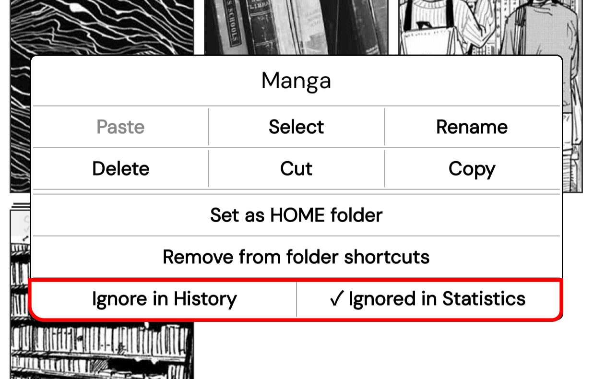
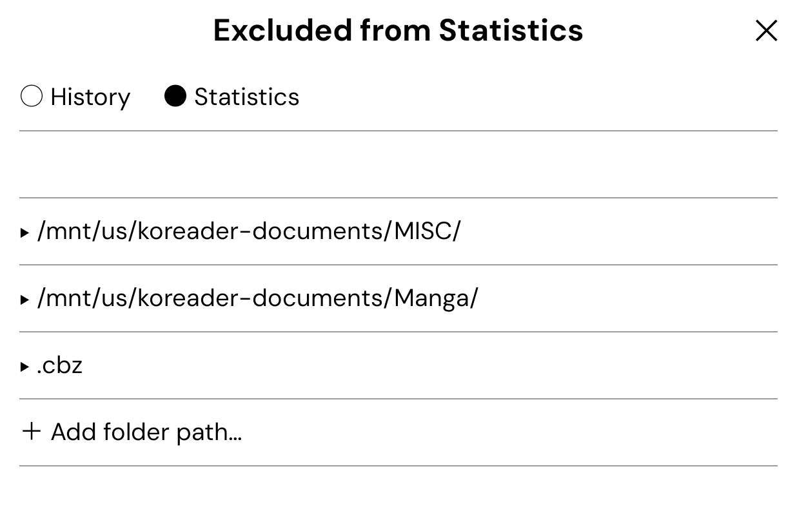
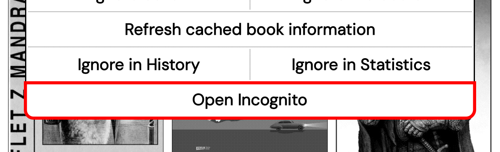
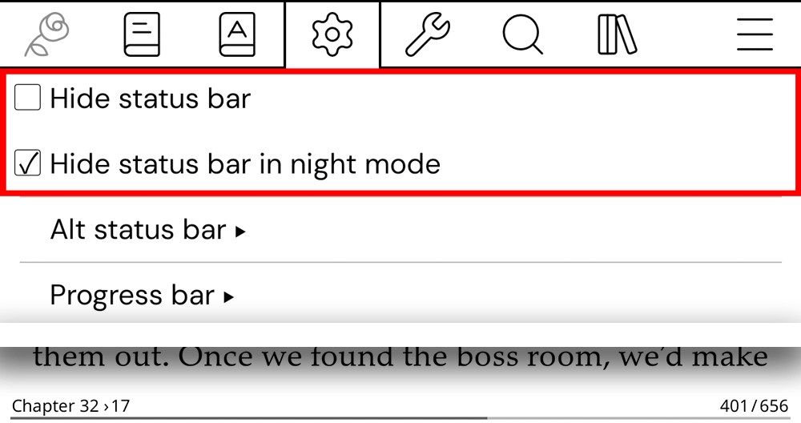
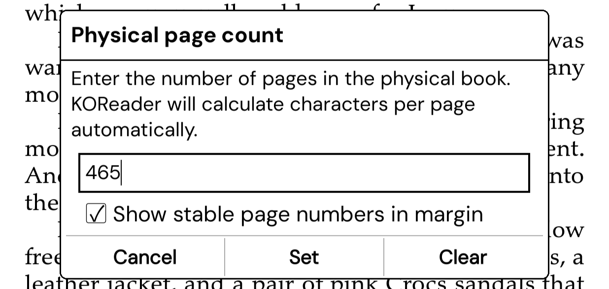

# KOReader Patches & Plugins

My user patches and plugins for [KOReader](https://github.com/koreader/koreader). Everything here is free and open source.

**Contents:** [Patches](#patches) · [Plugins](#plugins)

## Patches

Copy the `.lua` file into `koreader/patches/` and restart KOReader.

### [2-exclude-folders](2-exclude-folders.lua)

Keep selected folders or files out of Reading History and Statistics.

<picture></picture>
<picture></picture>

- **Long-press** a folder or file in File Manager to exclude it.
- **Tools → Exclude Folders & Files** shows the full list, where you can add or remove entries.
- **Tools → Exclude this book…** excludes the book you are reading.
- Folders match by partial name (`Manga` excludes every path containing it), files match exactly. Matching is case-sensitive.
- A file inside an excluded folder is greyed out, because the exclusion comes from the folder.
- Excluded entries disappear from History the next time you open it, and from Statistics after the book is reopened.

### [2-incognito](2-incognito.lua)

Open a book without leaving any trace. **Long-press** a file in File Manager → **Open Incognito**.

<picture></picture>

Nothing is saved: no history, statistics, progress, document settings, highlights, notes or `.sdr` folders.

> [!TIP]
> Prefer a plugin? [incognito.koplugin](https://github.com/Craftwork2720/incognito.koplugin) does the same and shows an icon while saving is blocked.

### [2-hide-status-bar](2-hide-status-bar.lua)

Hides the whole status bar (footer and, in CRE documents, the alt status bar), with optional auto-hide in night mode.

<picture></picture>

- **Config → Status bar → Hide status bar**: toggle, remembered between books.
- **Config → Status bar → Hide status bar in night mode**: hides it automatically in night mode.
- **Gestures / Profiles → Reader**: *Hide status bar* and *Show status bar* (temporary, not remembered) and *Toggle status bar visibility* (remembered).

The menu options only appear while a book is open.

### [2-physical-page-count](2-physical-page-count.lua)

Make the page counter match a printed edition. Enter the number of pages in the physical book and KOReader sets the characters-per-page value for you.

<picture></picture>

Find it in **Navigation → Match printed page numbers…**, or as a gesture / profile action. Works in reflowable books (epub, fb2, txt…).

### [2-filemanager-title-hide](2-filemanager-title-hide.lua)

Removes the large "KOReader" title from File Manager without leaving empty space. The current path stays visible.

### [2-filemanager-subtitle-margin](2-filemanager-subtitle-margin.lua)

Adds side padding to the path in the File Manager title bar, so it no longer overlaps the buttons.

<picture></picture>

> [!NOTE]
> The back arrow comes from a separate patch by sebdelsol: [2-browser-up-folder.lua](https://github.com/sebdelsol/KOReader.patches/blob/main/2-browser-up-folder.lua).

### [1-gettext-translate](1-gettext-translate.lua)

Add your own translations for any string in a community patch or plugin, without touching official KOReader files.

1. Set your language at the top of the file:

   ```lua
   local LANGUAGE = "pt_BR"  -- "pl", "pt_BR", "de", "fr", "es"...
   ```

2. Add your strings to the table for that language. Polish and Brazilian Portuguese are included. For another language, copy a table and register it in `catalogs`:

   ```lua
   pt_BR = {
       ["My English string"] = "Minha string em português",
   },
   ```

> [!NOTE]
> Only strings wrapped in `_("...")` can be translated. Official KOReader translations are never overwritten.

## Plugins

Extract the plugin folder into `koreader/plugins/` and restart KOReader.

### [Meguru](https://github.com/Craftwork2720/meguru)

Manga reader for `.cbz` files with OPDS streaming (Komga, Suwayomi, Kavita).

[](https://github.com/Craftwork2720/meguru/releases/latest/download/meguru.koplugin.zip)

### [dufs.koplugin](https://github.com/Craftwork2720/dufs.koplugin)

Manage the files on your e-reader from any browser on the same network.

[](https://github.com/Craftwork2720/dufs.koplugin/releases/latest/download/dufs.koplugin.zip)

### [pagenumbercrop.koplugin](https://github.com/Craftwork2720/pagenumbercrop.koplugin)

Removes page numbers from the bottom of manga pages (CBZ) when Page Crop is set to **auto**.

[](https://github.com/Craftwork2720/pagenumbercrop.koplugin/releases/latest/download/pagenumbercrop.koplugin.zip)
### [mupdftwopage.koplugin](https://github.com/Craftwork2720/mupdftwopage.koplugin)

Two-page view for the stock MuPDF reader. Shows two pages side by side.

[](https://github.com/Craftwork2720/mupdftwopage.koplugin/releases/latest/download/mupdftwopage.koplugin.zip)

### [foldermemory.koplugin](https://github.com/Craftwork2720/foldermemory.koplugin)

Remembers per-folder settings (sort, display mode, grid, book status filter) and restores them automatically.

[](https://github.com/Craftwork2720/foldermemory.koplugin/releases/latest/download/foldermemory.koplugin.zip)

### [incognito.koplugin](https://github.com/Craftwork2720/incognito.koplugin)

Open a book in incognito mode. Nothing from the session is saved.

[](https://github.com/Craftwork2720/incognito.koplugin/releases/latest/download/incognito.koplugin.zip)

<p align="center">
  Enjoying these? A coffee helps me keep them going ☕
  <br><br>
  <a href="https://ko-fi.com/Y8Y01JS8SV" target="_blank"></a>
</p>